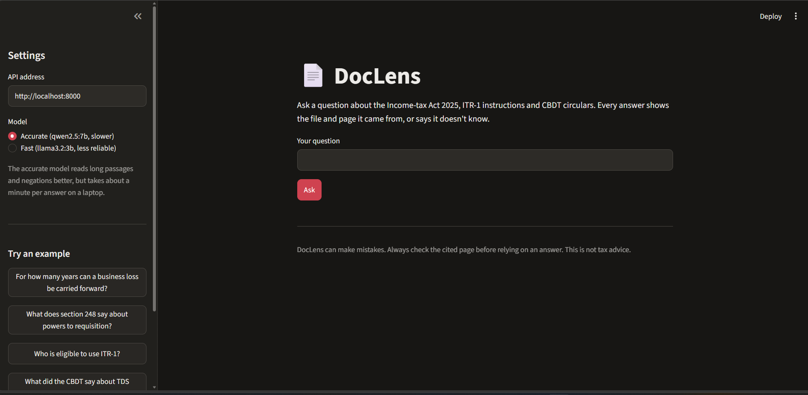
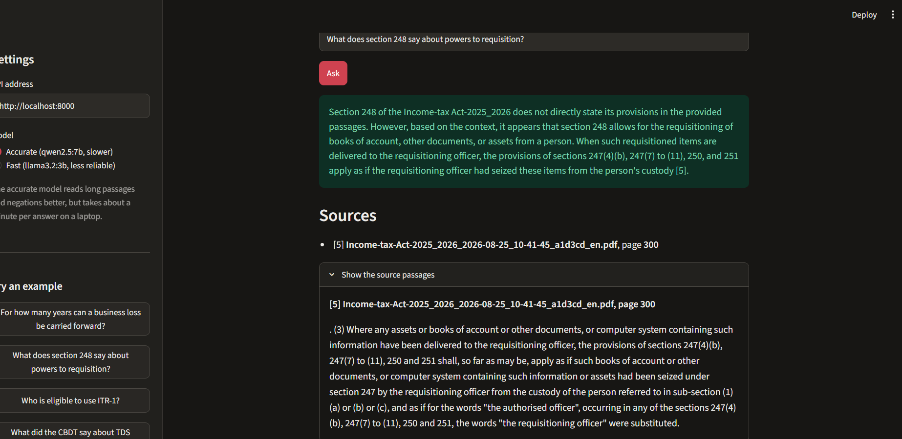
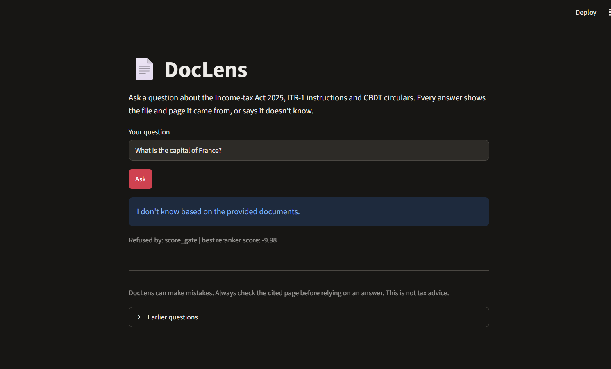

# DocLens

A question-answering system over Indian income-tax documents. You ask in plain language; it answers **with the source file and page**, or says **"I don't know"** when the documents don't contain the answer.



| Example answer with sources | Example refusal |
|---|---|
|  |  |

> DocLens can make mistakes and is **not tax advice**. Always check the cited page.

## What it does

- Answers questions from 731 pages of official documents: the Income-tax Act 2025 (674 pages), the ITR-1 instructions for AY 2021-22, and three CBDT circulars.
- Shows the file name, page number and the exact source passage for every answer.
- Refuses to answer when the documents don't support one. On my test set it correctly declined **12 of 12** unanswerable questions.
- Runs fully on a laptop: no paid API. The language model runs locally through Ollama.

## How it works

```
PDFs -> parse and clean -> chunk (1000 chars) -> embed (bge-small-en-v1.5) -> ChromaDB
                                                                                |
question -> vector search (30 candidates) -> cross-encoder reranker -> top 5 passages
                                                                                |
                      reranker-score gate: too low? -> "I don't know" (no model call)
                                                                                |
                      local LLM (Ollama) answers only from the passages, citing [1], [2]...
                                                                                |
                      answer + unique file/page sources + source passages (FastAPI + Streamlit)
```

Two layers decide when to refuse: a **score gate** (cheap, skips the model) and the **language model itself**, which is told to reply "I don't know" when the passages don't answer the question.

| Part | Choice |
|---|---|
| PDF parsing | PyMuPDF, with header/footer removal |
| Chunking | LangChain `RecursiveCharacterTextSplitter`, 1000 characters, 150 overlap, never crossing a page |
| Embeddings and vector store | `BAAI/bge-small-en-v1.5`, ChromaDB (cosine) |
| Reranker | `cross-encoder/ms-marco-MiniLM-L-6-v2` |
| Answer model | `qwen2.5:7b` (accurate) or `llama3.2:3b` (fast), via Ollama |
| Backend and UI | FastAPI, Streamlit |

## Evaluation

I built a **48-question test set** (`eval/questions.json`): 36 answerable questions, each labelled with the expected file and page, and 12 unanswerable ones (GST, stamp duty, PAN cards, the RBI repo rate, and so on). Everything below was measured on this set, and every run is saved in `eval/`.

### Experiment 1: chunk size (vector search only)

| Chunk size | Chunks | Right page ranked 1st | In top 5 | In top 10 | MRR |
|---|---|---|---|---|---|
| 500 | 5,143 | 61% | 97% | 97% | 0.762 |
| **1000** | 2,609 | 75% | 94% | 97% | 0.838 |
| 1500 | 1,803 | 81% | 94% | 94% | 0.863 |

Small chunks hurt top-1 accuracy. 1500 ranks slightly better at the top but loses recall in the top 10. With 36 questions the difference between 1000 and 1500 is about two questions, so I kept 1000: it had the best recall in the top 10, which a reranker needs to work with.

### Experiment 2: hybrid search and reranking (chunk size 1000)

| Method | Ranked 1st | In top 5 | In top 10 | MRR |
|---|---|---|---|---|
| Vector (baseline) | 75% | 94% | 97% | 0.838 |
| Hybrid (vector + BM25) | 69% | 89% | 100% | 0.784 |
| **Vector + reranker** | 75% | **97%** | **100%** | 0.836 |
| Hybrid + reranker | 72% | 97% | 97% | 0.817 |

Hybrid search found every answer within the top 10 but ranked many of them lower, so on its own it was a loss. The reranker did not improve the top-1 rate, but it raised the chance that the right page is among the 5 passages the model reads (94% to 97%). I used vector search plus the reranker.

### Experiment 3: when should the system say "I don't know"?

Vector distance cannot separate answerable from unanswerable questions (the ranges overlap). The reranker's score separates them much better:

| Refusal signal | Unanswerable refused | Good questions wrongly refused |
|---|---|---|
| Vector distance above 0.35 (best cutoff) | 4 of 12 (33%) | 0 of 36 |
| Reranker score below -5.6 | 6 of 12 (50%) | 0 of 36 |
| Reranker score below -0.8 | 8 of 12 (67%) | 2 of 36 (6%) |
| Reranker score below 1.6 | 12 of 12 (100%) | 4 of 36 (11%) |

Answerable questions had a median reranker score of +5.5, unanswerable ones -4.7. The final system uses a lenient gate (-2.0) and lets the language model make the final refusal call.

### Experiment 4: language model size

On my first test, `llama3.2:3b` read "no loss shall be carried forward for **more than** eight tax years" as "can be carried forward for more than eight years". It cited the right page but inverted the meaning. `qwen2.5:7b` answered correctly, and it also answered a question the 3B model wrongly refused. Retrieval was identical in both cases. The 7B model is the default; the 3B model is offered as a faster option (about 20-35 seconds per answer instead of 45-125).

### End-to-end results (qwen2.5:7b, all 48 questions)

| | Result |
|---|---|
| Unanswerable questions correctly refused | **12 / 12** (7 by the score gate, 5 by the model) |
| Answerable questions answered | 30 / 36 (83%) |
| Answers that cited a correct page | 28 / 30 (93%); 27 / 30 before the q30 label correction |
| Answerable questions correctly answered with the right page | 28 / 36 (78%); 27 / 36 before the correction |
| Answerable questions wrongly refused | 6 / 36 (17%) |

## Known limitations

- **It leans cautious.** 6 of 36 answerable questions were refused even though the answer was in the documents. One case (page 157 of the Act) was a clear over-refusal. For tax questions I prefer this to guessing, but it costs usefulness.
- **It can still be wrong.** For "What is the limit on receiving cash payments?" it answered Rs 10,000 from the wrong provision instead of Rs 200,000 (section 186). That answer had the lowest reranker score of any answered question (0.34), which suggests a stricter gate would catch cases like it. For another question it cited a similar section (section 86 instead of section 82).
- **Citation checks are coarse.** The evaluation checks that the cited page is correct, not that the wording of the answer is correct, so an answer can cite the right page and still misstate it. I read 5 answers against their cited pages (q01, q06, q13, q17, q31): none contained a wrong or invented fact, but q01 cited an unrelated extra page, q17 was hedged and incomplete because only part of the section reached the model, and q31 left out the list of people who cannot use ITR-1. I have not verified the other answers by hand.
- **The test set is small and partly tuned on.** The 48 questions were mostly written from the Act's own text, which makes them easier than real user questions, and I picked the refusal cutoff using the same questions. One label (q30) was corrected after error analysis because two sections both allow entry to a business place. Treat the numbers as indicative, not as a benchmark.
- **Mixed legal versions.** The ITR-1 instructions are for AY 2021-22 (the 1961 Act), while the main document is the Income-tax Act 2025.
- **Pages, not sections.** Citations use PDF page numbers. A section can start mid-page, and long sections span pages.
- **Slow on a laptop.** 45 to 125 seconds per answer with the 7B model. There is no hosted demo, because the model runs locally.

## Ideas for next steps

- Put each section's heading at the top of its chunks, and pull in neighbouring chunks when a section spans several.
- Give the model 8 passages instead of 5, with a softer prompt, and re-run the full evaluation.
- Add a held-out set of new questions to check the refusal cutoff honestly.
- Show section numbers in citations and check each cited sentence against the answer.
- Query rewriting, and a hosted demo with a free cloud model and only public documents.

## Run it yourself

The documents are not in this repository. They are public, official PDFs.

```powershell
git clone https://github.com/kushagra1305/doclens.git
cd doclens
python -m venv .venv
.\.venv\Scripts\Activate.ps1
pip install -r requirements.txt
```

1. **Get the documents.** Download these into `data/raw/` from incometaxindia.gov.in (English versions only):
   the Income-tax Act 2025, the ITR-1 instructions for AY 2021-22, and CBDT Circulars 2 of 2026, 7 of 2025 and 13 of 2025.
   If you use other documents, the evaluation questions will not match.
2. **Install Ollama** (ollama.com) and pull the models:
   ```powershell
   ollama pull qwen2.5:7b
   ollama pull llama3.2:3b
   ```
3. **Build the index** (about 5 minutes):
   ```powershell
   python src\ingest.py
   python src\chunk.py
   python src\index.py
   ```
4. **Start the app** in two terminals:
   ```powershell
   uvicorn app.api:app --reload
   streamlit run app\ui.py
   ```
5. **Reproduce the numbers:**
   ```powershell
   python src\evaluate.py --mode vecrerank --label vecrerank     # retrieval metrics
   python src\evaluate_e2e.py --label qwen7b_full                # full pipeline (about an hour)
   python src\show_problems.py qwen7b_full                       # list the failures
   ```

## Project layout

```
doclens/
├── src/
│   ├── ingest.py        parse PDFs into clean pages
│   ├── chunk.py         split pages into chunks (--size, --overlap)
│   ├── index.py         embed chunks and store them in ChromaDB
│   ├── retrieve.py      vector, hybrid and reranked search
│   ├── generate.py      refusal gate, prompt, local LLM, citations
│   ├── evaluate.py      retrieval metrics and refusal cutoff table
│   ├── evaluate_e2e.py  full-pipeline evaluation
│   ├── check_answers.py show an answer next to the pages it cited
│   └── show_problems.py error analysis
├── app/
│   ├── api.py           FastAPI backend
│   └── ui.py            Streamlit front end
├── eval/                questions and results of every run
├── docs/                screenshots
└── requirements.txt
```